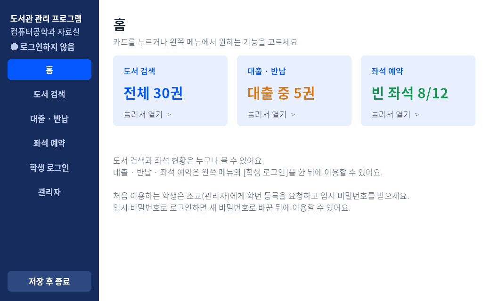
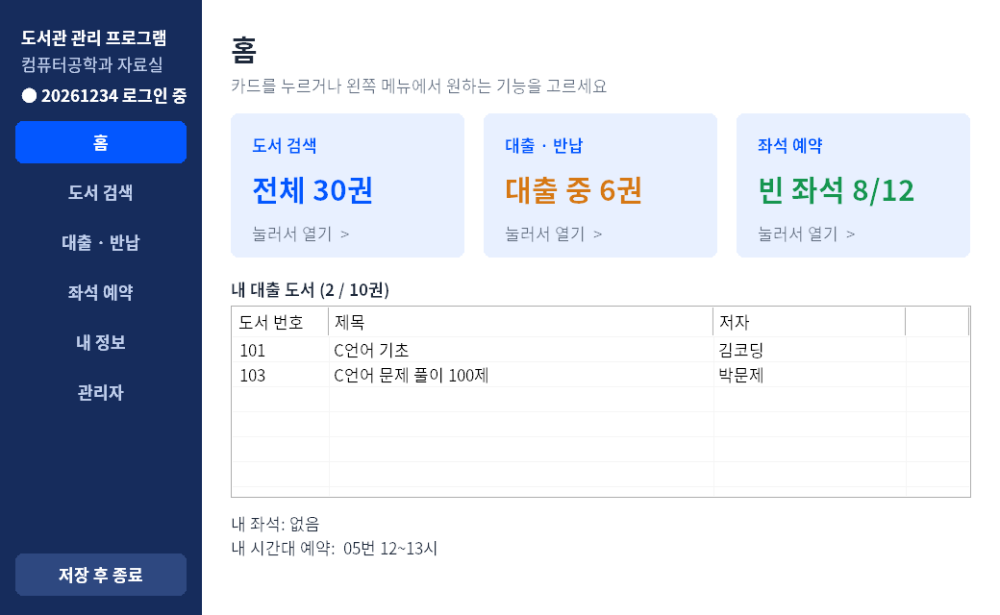
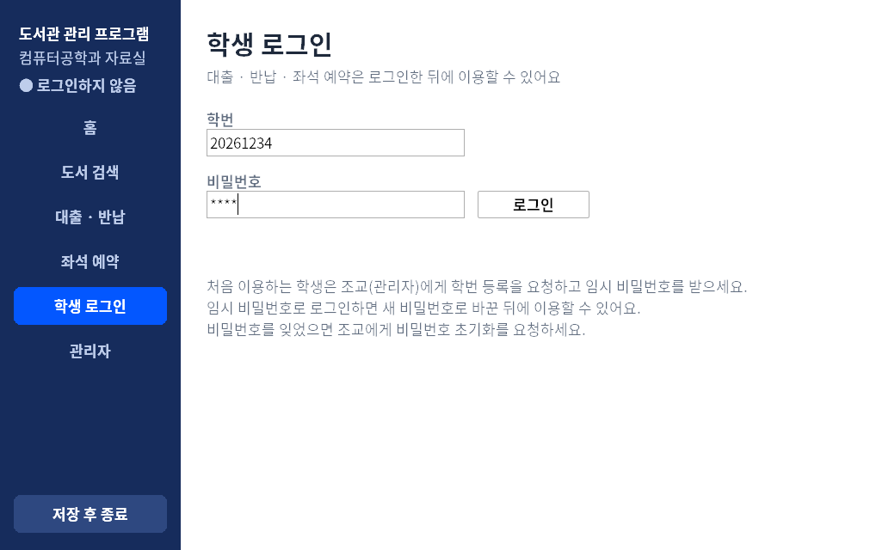
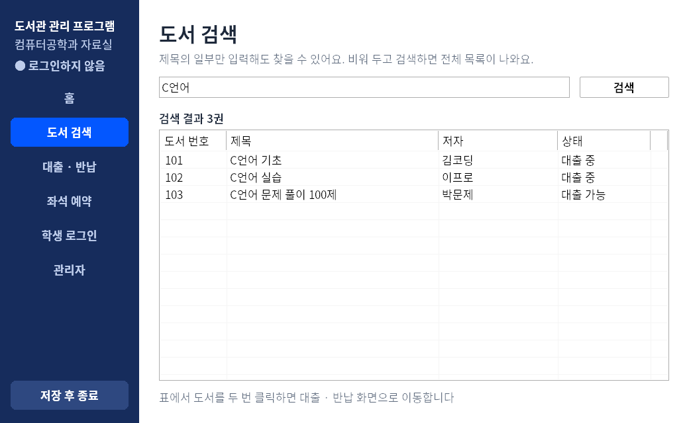
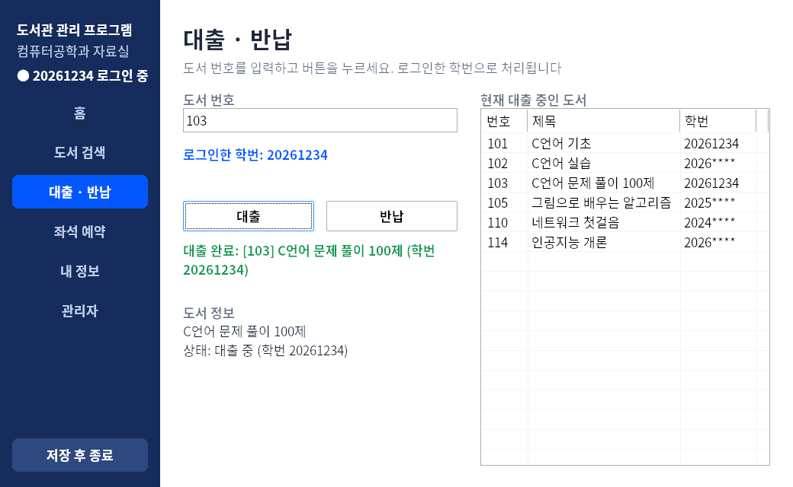
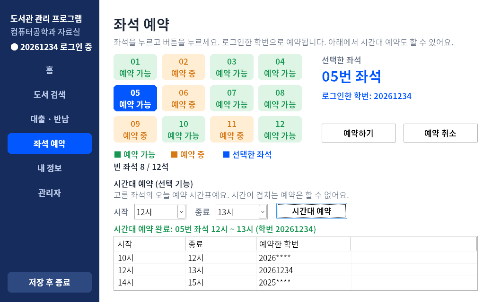
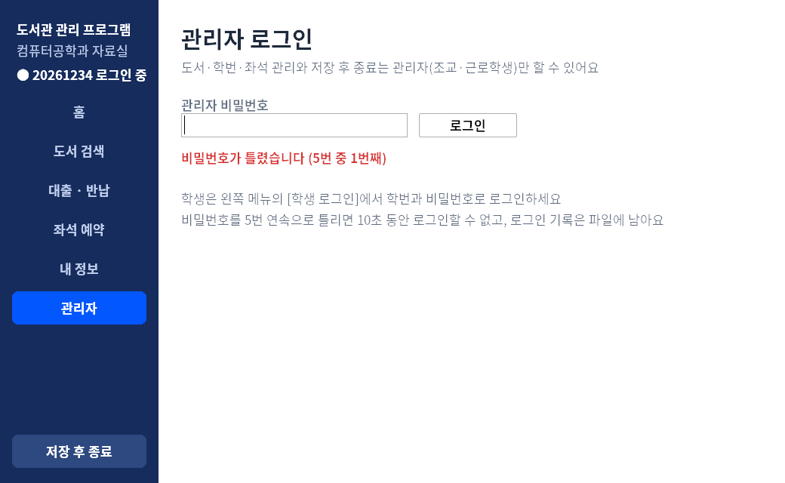
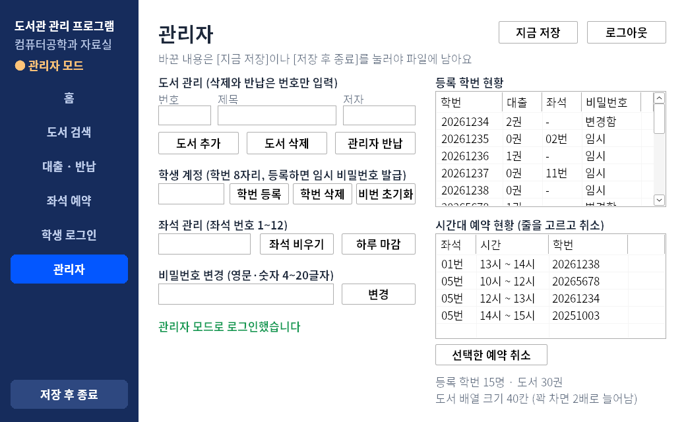
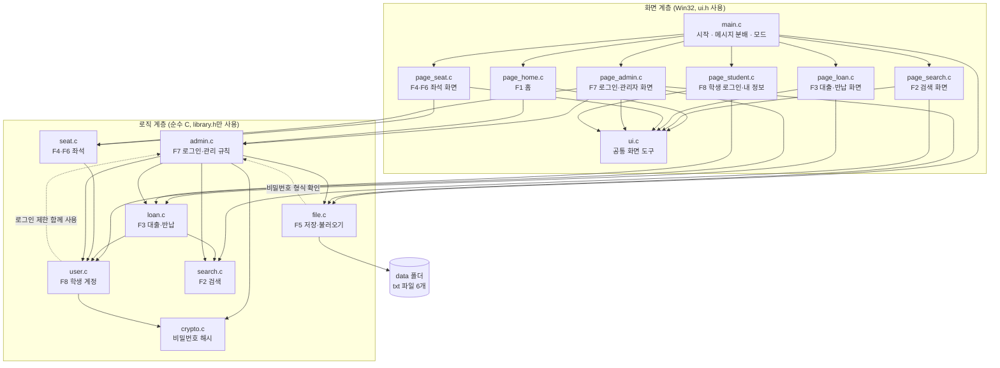

# 도서관 관리 프로그램 (비판적사고 4팀)

컴퓨터공학과 학과 자료실에서 **도서 검색, 도서 대출·반납, 열람 좌석 예약**을 한 화면에서 처리하는 C언어 GUI 프로그램입니다.
학생은 **학번과 비밀번호로 로그인**해서 대출·반납·좌석 예약을 하고, 조교·근로학생은 관리자 비밀번호로 로그인해 **관리자 모드**에서 도서·학생 계정·좌석을 관리합니다.
Windows의 기본 화면 기능(Win32 API)으로 만들어서, Visual Studio만 있으면 따로 설치할 것 없이 바로 실행됩니다.



> 화면 사진은 테스트 환경에서 찍은 것이라, 실제 Windows에서는 버튼 모양이나 글꼴이 조금 다르게 보일 수 있습니다.

**처음 관리자 비밀번호: `admin1234`** · **샘플 학생 계정: 학번 `20261234`, 비밀번호 `pass1234`** (다른 샘플 계정은 8장)

비밀번호는 모두 파일에 그대로 저장하지 않고 **해시 값**만 저장합니다.

---

## 목차

1. [프로젝트 소개](#1-프로젝트-소개)
2. [실행 방법](#2-실행-방법)
3. [화면별 사용 방법](#3-화면별-사용-방법)
4. [폴더 구조와 담당자](#4-폴더-구조와-담당자)
5. [프로그램 구조 (모듈 관계)](#5-프로그램-구조-모듈-관계)
6. [동작 흐름: 버튼 하나를 누르면 생기는 일](#6-동작-흐름-버튼-하나를-누르면-생기는-일)
7. [공통 약속: library.h](#7-공통-약속-libraryh)
8. [데이터 파일 형식](#8-데이터-파일-형식)
9. [Win32 기초 개념 (화면 코드를 읽기 전에)](#9-win32-기초-개념-화면-코드를-읽기-전에)
10. [사용한 C언어 개념과 위치](#10-사용한-c언어-개념과-위치)
11. [담당자별 설명 가이드](#11-담당자별-설명-가이드)
12. [시연 시나리오 (정상 입력 + 잘못된 입력)](#12-시연-시나리오-정상-입력--잘못된-입력)
13. [호환성과 자주 나는 오류](#13-호환성과-자주-나는-오류)
14. [협업 규칙 (GitHub)](#14-협업-규칙-github)
15. [알고 있는 한계와 개선 아이디어](#15-알고-있는-한계와-개선-아이디어)
16. [AI 활용 안내](#16-ai-활용-안내)

---

## 1. 프로젝트 소개

### 이용 대상과 세 가지 상태

| 상태 | 누구 | 들어가는 방법 | 할 수 있는 일 |
|---|---|---|---|
| 로그인하지 않음 | 누구나 | 프로그램을 켜면 바로 | 도서 검색, 대출 현황·좌석 현황 보기 (학번은 `2026****`처럼 가려짐). 대출·예약 버튼을 누르면 로그인 화면으로 이동 |
| 학생 로그인 | 컴퓨터공학과 재학생 (관리자가 등록한 학번) | 왼쪽 메뉴 [학생 로그인] → 학번 + 비밀번호 | 자기 학번으로 대출·반납(10권까지), 좌석 예약·취소, 시간대 예약. 홈에서 내 대출 도서와 내 좌석 확인. 비밀번호 변경 |
| 관리자 모드 | 학과 조교·근로학생 | 왼쪽 메뉴 [관리자] → 관리자 비밀번호 | 도서 추가·삭제, 관리자 반납, 학생 계정 등록·삭제·비밀번호 초기화, 좌석 비우기, 시간대 예약 취소, 하루 마감, **처리 내역 보기**, **저장과 종료**. 학번을 입력해 학생 대신 대출·예약 처리 |

**학생 계정이 만들어지는 과정**
1. 학생이 조교에게 등록을 요청한다.
2. 관리자가 [학번 등록]을 누르면 **임시 비밀번호**(무작위 8글자)가 창에 한 번 표시된다. 관리자가 학생에게 전달한다.
3. 학생이 학번과 임시 비밀번호로 로그인하면 **비밀번호 변경 화면**이 뜨고, 새 비밀번호로 바꾸기 전에는 다른 기능을 쓸 수 없다.
4. 비밀번호를 잊으면 관리자가 [비번 초기화]로 임시 비밀번호를 다시 발급한다. (관리자도 학생의 비밀번호는 볼 수 없다)

이용 환경: 학과 자료실 PC 1대, 전공 도서 약 100권(샘플 데이터는 30권), 열람 좌석 12석

### 기능

| 번호 | 기능 | 구분 | 담당 | 설명 |
|---|---|---|---|---|
| F1 | 메인 화면 메뉴 | 필수 | 권순욱 | 왼쪽 메뉴와 홈 카드로 기능을 고름. 홈 아래쪽은 상태에 따라 이용 안내 / 내 대출·내 좌석 / 처리 내역(관리자만) |
| F2 | 도서 검색 | 필수 | 송영준 | 제목 일부로 검색, 대출 가능 여부 표시, 두 번 클릭하면 대출 화면으로 이동 |
| F3 | 도서 대출·반납 | 필수 | 유강훈 | 로그인한 학번으로 처리. 중복 대출, 10권 초과 대출, 대출자가 아닌 학생의 반납을 거절 |
| F4 | 좌석 예약·취소 | 필수 | 류지언 | 로그인한 학번으로 처리. 좌석 상태를 색으로 표시, 한 학번당 좌석 하나, 예약한 학번만 취소 |
| F5 | 저장·불러오기 | 필수 | 최민호 | 시작할 때 data 폴더에서 불러오고, 관리자가 저장. 실패하면 안내 후 홈으로 |
| F6 | 시간대별 좌석 예약 | 선택 | 류지언 | 같은 좌석의 기존 예약과 시간이 겹치면 거절 |
| F7 | 관리자 로그인·관리 | 추가 | 송영준 | 비밀번호 로그인(5번 틀리면 10초 잠금, 로그인 기록 파일), 도서·학번·좌석·시간대 예약 관리, 저장 후 종료는 관리자만 |
| F8 | 학생 로그인 | 추가 | 최민호 | 학번 + 비밀번호 로그인(5번 틀리면 10초 잠금), 임시 비밀번호는 로그인 후 반드시 변경, 1분 동안 쓰지 않으면 자동 로그아웃 |
| 보안 | 비밀번호 해시 저장 | 추가 | 유강훈 | 관리자와 학생의 비밀번호를 그대로 저장하지 않고 솔트를 붙인 해시(PBKDF2-SHA256)로 저장 |
| 도전 | 도서 배열 동적 확장 | 도전 | 최민호 | 도서가 많아지면 `realloc`으로 배열을 2배씩 늘림 (관리자 화면에서 배열 크기 확인) |

> F7, F8과 해시 저장은 제안서 이후에 추가한 기능입니다. 제안서의 "학번으로 이용"은 학번만 알면 남의 이름으로 대출할 수 있어서, 로그인 방식으로 바꿨습니다. 담당은 코드 분량을 보고 정한 것이라 팀 회의로 바꿔도 됩니다(파일 맨 위 주석과 이 문서의 이름만 고치면 됩니다).

---

## 2. 실행 방법

### 2-1. Visual Studio (2019, 2022, 2026) — 기본 방법

1. 압축을 풀고 `c4team` 폴더 안의 **`LibraryProgram.sln`** 을 더블클릭합니다.
2. "이 프로젝트를 신뢰하시겠습니까?" 같은 창이 뜨면 신뢰를 선택합니다.
3. 위쪽 도구 모음이 **Debug / x64** 인지 확인합니다.
4. **F5**(디버깅 시작) 또는 **Ctrl+F5**(디버그하지 않고 시작)를 누릅니다.

> 프로젝트가 설치된 Visual Studio의 기본 빌드 도구(2019는 v142, 2022는 v143, 2026은 v145)를 자동으로 씁니다.
> `MSB8020: v14x에 대한 빌드 도구를 찾을 수 없습니다` 오류가 나면 13장을 보세요.

빌드하면 `c4team` 폴더(= data 폴더 옆)에 `LibraryProgram.exe` 가 생깁니다. 다음부터는 이 파일을 더블클릭해도 실행됩니다.

### 2-2. 직접 프로젝트를 만드는 경우 (솔루션 파일이 안 열릴 때)

1. Visual Studio → 새 프로젝트 → **빈 프로젝트**(C++)를 만듭니다.
2. 솔루션 탐색기에서 소스 파일 → 추가 → **기존 항목** → `src` 폴더의 `.c`, `.h` 파일 17개를 모두 추가합니다.
3. 프로젝트 속성(구성: **모든 구성**)에서 아래 2가지를 설정합니다.

| 위치 | 값 | 이유 |
|---|---|---|
| 링커 → 시스템 → 하위 시스템 | **창 (/SUBSYSTEM:WINDOWS)** | `main` 대신 `WinMain`으로 시작하는 윈도우 프로그램 |
| C/C++ → 명령줄 → 추가 옵션 | **`/utf-8`** | 소스 파일의 한글을 UTF-8로 읽기 (안 하면 한글이 깨짐) |

4. F5로 실행합니다. 프로그램이 실행 파일 위치에서 위쪽 폴더로 올라가며 `data` 폴더를 스스로 찾으므로(3단계까지), `data` 폴더가 프로젝트 폴더나 그 위에 있으면 됩니다.

### 2-3. Visual Studio가 없을 때: gcc (MinGW-w64)

`build_gcc.bat` 을 더블클릭하면 같은 폴더에 `LibraryProgram.exe` 가 만들어집니다. (gcc가 설치되어 있고 PATH에 등록되어 있어야 합니다)
직접 입력하려면 `c4team` 폴더에서 아래 명령을 실행합니다.

```
gcc -std=c99 src\main.c src\ui.c src\page_home.c src\page_search.c src\page_loan.c src\page_seat.c src\page_admin.c src\page_student.c src\user.c src\search.c src\loan.c src\seat.c src\file.c src\admin.c src\crypto.c -o LibraryProgram.exe -mwindows -lcomctl32 -lgdi32
```

---

## 3. 화면별 사용 방법

왼쪽 메뉴는 모든 화면에서 보이고, 지금 화면이 파란색으로 표시됩니다. 프로그램 이름 아래에 지금 상태(**로그인하지 않음 / 학번 로그인 중 / 관리자 모드**)가 보입니다.
**Tab** 키로 입력칸을 옮겨 다닐 수 있고, 검색·로그인·비밀번호 변경 화면에서는 **Enter** 키가 버튼과 같습니다.

### F1 홈 (메인 화면)
- 카드 3개에 **전체 도서 수, 대출 중인 도서 수, 빈 좌석 수**가 보입니다. 카드를 누르면 해당 화면으로 이동합니다.
- 카드 아래쪽은 상태에 따라 달라집니다.
  - 로그인하지 않음: 이용 안내 (맨 위 사진)
  - 학생 로그인: **내 대출 도서** 표(몇 권 / 10권)와 **내 좌석, 내 시간대 예약**
  - 관리자 모드: **최근 처리 내역**(대출·반납·예약·관리자 작업 기록). 학생에게는 보이지 않습니다.



### F8 학생 로그인 / 내 정보

- 왼쪽 메뉴 [학생 로그인]에서 학번과 비밀번호를 입력하고 [로그인] 또는 Enter. 틀리면 "학번 또는 비밀번호가 틀렸습니다"라고만 알려 줍니다(어느 쪽이 틀렸는지는 알려 주지 않음).
- 5번 연속으로 틀리면 10초 동안 로그인할 수 없습니다.
- **임시 비밀번호**로 로그인하면 바로 [내 정보] 화면이 뜨고, 새 비밀번호(영문·숫자 4~20글자)를 두 번 입력해 바꿔야 다른 화면으로 갈 수 있습니다.
- 로그인하면 메뉴 이름이 [내 정보]로 바뀝니다. 여기서 비밀번호 변경과 [로그아웃]을 합니다.
- **1분 동안 키보드·마우스를 쓰지 않으면 자동으로 로그아웃**됩니다. 로그아웃하면 입력했던 내용과 결과 안내가 모두 지워집니다.
- 로그인하지 않고 [대출], [예약하기] 등을 누르면 이 화면으로 옵니다.

### F2 도서 검색

- 로그인 없이 누구나 쓸 수 있습니다. 제목의 일부를 입력하고 [검색]을 누르거나 Enter를 칩니다. 비워 두고 검색하면 전체 목록이 나옵니다.
- 표에서 도서를 **두 번 클릭**하면 그 도서 번호가 채워진 채로 대출·반납 화면으로 이동합니다.

### F3 대출·반납

- 도서 번호를 입력하고 [대출] 또는 [반납]을 누르면 **로그인한 학번**으로 처리됩니다. 한 학생은 동시에 **10권**까지 빌릴 수 있습니다.
- 도서 번호를 입력하는 순간 아래 **도서 정보**(제목, 상태)가 바로 바뀝니다.
- 성공하면 초록색, 거절하면 빨간색으로 이유가 표시됩니다. 오른쪽 표는 현재 대출 중인 도서 목록입니다.
- 표에서 내 학번은 그대로, 다른 학생의 학번은 `2026****`처럼 가려져 보입니다. 관리자 모드에서는 전부 보입니다.
- 관리자 모드에서는 학번 입력칸이 나타나서, 학생 대신 처리할 학번을 적을 수 있습니다.

### F4 좌석 예약·취소 / F6 시간대 예약

- 좌석 색: **초록 = 예약 가능, 주황 = 예약 중, 파랑 = 지금 고른 좌석**
- 좌석을 누르고 [예약하기] 또는 [예약 취소]를 누르면 로그인한 학번으로 처리됩니다.
- 아래쪽(선택 기능 F6)은 고른 좌석의 **오늘 시간대 예약표**입니다. 시작·종료 시각을 고르고 [시간대 예약]을 누르면, 기존 예약과 겹치는지 검사한 뒤 시작 시각 순서로 들어갑니다.

### F7 관리자 로그인

- 왼쪽 메뉴 [관리자]를 누르면 로그인 화면이 나옵니다. 비밀번호를 입력하고 [로그인] 또는 Enter.
- 로그인하면 왼쪽 위 표시가 **관리자 모드**로 바뀌고, [관리자] 메뉴가 관리자 화면으로 연결됩니다. 학생이 로그인해 있었다면 자동으로 로그아웃됩니다(반대도 같음).
- 비밀번호를 **5번 연속으로 틀리면 10초 동안** 입력칸과 버튼이 잠기고 남은 시간이 표시됩니다. 그 뒤에도 틀릴 때마다 다시 10초씩 잠깁니다. 로그인에 성공하면 횟수가 0으로 돌아갑니다.
- 로그인 성공·실패·잠금과 로그아웃은 시각과 함께 `data/admin_log.txt`에 바로 기록됩니다(화면에는 보이지 않음).

### F7 관리자 화면


| 묶음 | 버튼 | 하는 일 | 거절하는 경우 |
|---|---|---|---|
| 도서 관리 | 도서 추가 | 번호·제목·저자로 새 도서 추가 | 빈칸(빈칸으로 시작하는 제목 포함), 제목·저자에 쉼표, 이미 있는 번호 |
| | 도서 삭제 | 번호의 도서를 삭제 | 없는 번호, 대출 중인 도서 |
| | 관리자 반납 | 학번 없이 번호만으로 반납 처리 (책만 두고 간 경우) | 없는 번호, 대출 중이 아닌 도서 |
| 학생 계정 | 학번 등록 | 8자리 학번으로 계정을 만들고 **임시 비밀번호를 창에 한 번 표시** | 8자리가 아님, 이미 등록됨, 명단 가득(200명) |
| | 학번 삭제 | 계정 삭제 | 등록되지 않음, 대출·좌석·시간대 예약이 남아 있음 |
| | 비번 초기화 | 비밀번호를 잊은 학생에게 임시 비밀번호를 다시 발급 (다음 로그인 때 변경해야 함) | 등록되지 않음 |
| 좌석 관리 | 좌석 비우기 | 좌석 하나의 예약을 해제 | 없는 좌석, 예약되지 않은 좌석 |
| | 하루 마감 | 모든 좌석 예약과 시간대 예약을 비움 (확인 창이 한 번 뜸, 도서 대출은 그대로) | - |
| 시간대 예약 현황 | 선택한 예약 취소 | 표에서 고른 시간대 예약 한 건을 그 예약의 학번으로 취소 | 표에서 줄을 고르지 않음 |
| 비밀번호 변경 | 변경 | 관리자 비밀번호 변경 | 영문·숫자 4~20글자가 아님 |
| 위쪽 | 지금 저장 | 종료하지 않고 data 폴더에 저장 | 저장 실패 |
| | 로그아웃 | 관리자 모드를 끝내고, 관리자 화면에 입력했던 내용을 모두 지움 | - |

- 오른쪽 위 표는 **등록 학번 현황**(학번, 대출 중인 권수, 예약 좌석, 비밀번호가 임시인지 학생이 변경했는지), 오른쪽 아래 표는 모든 좌석의 **시간대 예약 현황**이고, 맨 아래에 도서 수와 **도서 배열 크기**가 보입니다.
- 바꾼 내용(비밀번호 포함)은 **[지금 저장]이나 [저장 후 종료]를 눌러야** 파일에 남습니다.

### F5 저장과 종료 (관리자만)
- 왼쪽 아래 [저장 후 종료]는 **관리자 모드에서만** 동작합니다. 관리자가 아닐 때 누르면 안내 후 관리자 로그인 화면으로 이동합니다. (자료실 PC에서 학생이 실수로 프로그램을 꺼서 기록이 사라지는 일을 막기 위해서입니다)
- 창의 X 버튼도 같습니다. 관리자 모드에서는 "종료하기 전에 저장할까요?"를 묻습니다. 예 = 저장 후 종료, 아니요 = 저장 없이 종료, 취소 = 계속 사용
- 저장에 실패하면 오류를 안내하고 홈 화면으로 돌아갑니다(데이터는 그대로 남아 있음).
- 개발 중에 빨리 끄고 싶으면 Visual Studio의 **디버깅 중지(Shift+F5)** 를 쓰면 됩니다(저장되지 않음).

---

## 4. 폴더 구조와 담당자

```
c4team/
├─ LibraryProgram.sln            Visual Studio 솔루션 (더블클릭해서 열기)
├─ LibraryProgram.vcxproj        프로젝트 설정 (/utf-8, 하위 시스템, 기본 빌드 도구 사용)
├─ LibraryProgram.vcxproj.filters  솔루션 탐색기에서 파일을 4묶음으로 보여주는 설정
├─ build_gcc.bat                 Visual Studio가 없을 때 gcc로 빌드하는 파일
├─ README.md                     지금 이 문서
├─ .gitignore                    GitHub에 올리지 않을 파일 목록
├─ src/
│  ├─ library.h      [공통] 상수·결과 코드·구조체·로직 함수 선언        권순욱
│  ├─ ui.h           [공통] 화면 번호·컨트롤 ID·색·화면 함수 선언        권순욱
│  ├─ user.c         [로직] F8 학생 계정: 등록 확인, 학생 로그인, 비밀번호 변경  최민호
│  ├─ search.c       [로직] F2 제목 검색, 도서 번호로 찾기               송영준
│  ├─ loan.c         [로직] F3 대출·반납 규칙                            유강훈
│  ├─ seat.c         [로직] F4 좌석 예약·취소, F6 시간대 예약 규칙        류지언
│  ├─ file.c         [로직] F5 저장·불러오기, 도서 동적 배열(도전)        최민호
│  ├─ admin.c        [로직] F7 로그인(시도 제한), 도서·학번·좌석 관리 규칙  송영준
│  ├─ crypto.c       [로직] 비밀번호 해시 계산 (SHA-256, PBKDF2)          유강훈
│  ├─ main.c         [화면] WinMain, 메시지 처리, 화면 이동, 모드, 종료   권순욱
│  ├─ ui.c           [화면] 컨트롤 만들기, 화면 전환, 표, 한글 변환, 그리기 권순욱
│  ├─ page_home.c    [화면] F1 홈 화면                                  권순욱
│  ├─ page_search.c  [화면] F2 검색 화면                                송영준
│  ├─ page_loan.c    [화면] F3 대출·반납 화면                            유강훈
│  ├─ page_seat.c    [화면] F4·F6 좌석 화면                             류지언
│  ├─ page_admin.c   [화면] F7 관리자 로그인 화면, 관리자 화면            송영준
│  └─ page_student.c [화면] F8 학생 로그인 화면, 내 정보 화면             최민호
├─ data/             (최민호)
│  ├─ books.txt      도서 목록과 대출 상태
│  ├─ seats.txt      좌석 예약 상태
│  ├─ slots.txt      시간대 예약 (F6)
│  ├─ users.txt      학생 계정 명단 (학번, 임시 여부, 솔트, 해시)
│  ├─ admin.txt      관리자 비밀번호의 솔트와 해시 (F7, 비밀번호 자체는 없음)
│  └─ admin_log.txt  관리자 로그인 기록 (실행 중에 자동으로 만들어짐, GitHub에는 올리지 않음)
├─ res/              gcc로 빌드할 때만 쓰는 파일 (버튼·표를 최신 윈도우 모양으로)
└─ docs/
   ├─ flowchart.png  프로그램 흐름도 (제안서와 같은 그림)
   └─ screenshots/   README에 쓰인 화면 사진
```

**규칙: 한 사람이 "로직 파일 + 화면 파일" 한 쌍을 맡습니다.** 예를 들어 유강훈은 대출 규칙(`loan.c`)과 대출 화면(`page_loan.c`)을 함께 설명합니다. 최민호는 파일 저장(`file.c`)과 학생 계정(`user.c` + `page_student.c`) 두 가지를 맡습니다. 공통 파일은 권순욱, 해시 계산(`crypto.c`)은 유강훈이 맡습니다.

---

## 5. 프로그램 구조 (모듈 관계)

프로그램은 **화면 계층**과 **로직 계층** 두 층으로 나뉩니다.



| 계층 | 하는 일 | 특징 |
|---|---|---|
| 로직 계층 | 규칙 검사와 데이터 변경 (검색, 대출 가능 여부, 시간 겹침, 비밀번호 확인, 파일 읽고 쓰기) | Win32를 전혀 모름. 결과를 `Result` 값으로 돌려줌 |
| 화면 계층 | 입력칸 읽기, 로직 함수 부르기, 결과를 색과 문구로 보여주기, 로그인 여부 확인 | 로직 함수를 부르기만 하고 규칙은 직접 검사하지 않음 |

이렇게 나눈 이유:
- 규칙(로직)은 화면과 상관없이 똑같이 동작하므로, **콘솔 프로그램에서도 그대로 테스트**할 수 있습니다.
- 화면 모양을 바꿔도 규칙 코드는 건드리지 않아도 됩니다.
- 팀원이 각자 파일을 맡아도 **`library.h`의 선언만 보고** 다른 팀원의 함수를 가져다 쓸 수 있습니다. (예: `admin.c`가 `find_book_index()`, `is_registered()`, `add_book()`, `hash_password()`를 사용)

**누가 쓰고 있는지는 `main.c`의 전역 변수 두 개로 구분합니다.**
`int g_student_id` (로그인한 학생의 학번, 없으면 0), `int g_is_admin` (관리자면 1). 둘이 동시에 켜지지는 않습니다.

| 어디서 | 두 변수로 하는 일 |
|---|---|
| `page_student.c` `do_login()` / `student_logout()` | 학번·비밀번호가 맞으면 `g_student_id = 학번`, 로그아웃하면 0 |
| `page_admin.c` `do_login()` / `admin_logout()` | 관리자 비밀번호가 맞으면 `g_is_admin = 1`, 로그아웃하면 0 |
| `main.c` `app_go_to_page()` | 로그인 없이 내 정보·관리자 화면으로 가면 로그인 화면으로 보냄. 임시 비밀번호인 학생은 내 정보 화면으로만 보냄 |
| `main.c` `app_acting_student()` | 대출·예약을 누구 학번으로 처리할지 정함: 학생이면 `g_student_id`, 관리자면 입력칸의 학번, 아무도 아니면 로그인 화면으로 |
| `main.c` `check_idle_logout()` | 학생이 60초 동안 입력이 없으면 자동 로그아웃 |
| `main.c` `require_admin()` | 관리자가 아니면 [저장 후 종료]와 X 버튼을 막음 |
| `page_home.c` `home_refresh()` | 홈 아래쪽을 이용 안내 / 내 정보 / 처리 내역 중 하나만 보이게 함 |
| `ui.c` `ui_student_text()` | 관리자이거나 자기 학번이면 그대로, 아니면 뒤 4자리를 가림 |
| `ui.c` `ui_student_input_mode()` | 대출·좌석 화면의 학번 입력칸을 관리자에게만 보여 줌 |

**추천하는 코드 읽기 순서**: `library.h` → `user.c` → `search.c` → `loan.c` → `seat.c` → `file.c` → `admin.c` → `ui.h` → `main.c` → `ui.c` → `page_*.c` → (마지막에) `crypto.c`

> `crypto.c`는 공개 표준 알고리즘(SHA-256, HMAC, PBKDF2)을 옮긴 파일이라 수업 범위를 넘습니다. 한 줄씩 이해할 필요는 없고, **"무엇을 넣으면 무엇이 나오는지"와 "왜 쓰는지"**(11장 유강훈)를 설명할 수 있으면 됩니다. 나머지 파일은 1~2학년 수준으로 유지했습니다.

---

## 6. 동작 흐름: 버튼 하나를 누르면 생기는 일

### 프로그램 전체 흐름 (흐름도: `docs/flowchart.png`)

1. `WinMain` (main.c)이 `find_data_folder()`로 data 폴더를 찾고, `load_all()` (file.c)로 파일을 불러옵니다. 파일이 없으면 초기 데이터를 씁니다.
2. 화면 가운데에 창을 만들고, 왼쪽 메뉴와 화면 8개의 컨트롤을 **한 번에 모두** 만듭니다(처음에는 숨김).
3. 홈 화면(로그인하지 않은 상태)을 보여주고 **메시지 반복**(`GetMessageW` → `IsDialogMessageW` → `DispatchMessageW`)에 들어갑니다.
4. 사용자가 무언가를 누를 때마다 윈도우가 `window_proc()`으로 메시지를 보내고, 알맞은 화면 파일의 함수가 처리합니다.
5. 관리자가 [저장 후 종료] 또는 X 버튼 → `save_all()` (file.c) → 창 닫기 → 메모리 정리(`free_all()`).

### 예시 1: 대출 화면에서 [대출] 버튼을 누르면

```
[대출] 클릭
 → 윈도우가 WM_COMMAND 메시지를 보냄 (ID = ID_LOAN_BORROW, 알림 코드 = BN_CLICKED)
 → main.c   window_proc() → on_command()     : ID가 300번대라서 대출 화면 담당
 → page_loan.c  loan_page_command() → do_borrow()
      ├ ui_get_number()로 도서 번호 읽기                           (ui.c)
      ├ app_acting_student() : 로그인한 학번 (없으면 로그인 화면으로) (main.c)
      ├ borrow_book() 호출                                         (loan.c)
      │    ├ is_registered()  : 등록된 학번인가?                  (user.c)
      │    ├ find_book_index(): 그 번호의 도서가 몇 번째 칸인가?   (search.c)
      │    └ 이미 대출 중이면 ERR_ALREADY_BORROWED, 아니면 상태를 바꾸고 RESULT_OK
      ├ ui_show_result() : 성공이면 초록 문구, 실패면 빨간 이유     (ui.c)
      ├ home_add_log()   : 성공이면 홈 화면 처리 내역에 한 줄 추가  (page_home.c)
      └ loan_page_refresh(): 오른쪽 대출 중인 도서 표 새로 고침
```

### 예시 2: 관리자 로그인

```
왼쪽 메뉴 [관리자] 클릭 (ID_MENU_ADMIN)
 → main.c  on_command() → app_go_to_page(PAGE_ADMIN)
      └ g_is_admin 이 0 이므로 PAGE_LOGIN(로그인 화면)으로 바꿔서 보여줌
비밀번호 입력 후 [로그인] 클릭 또는 Enter
 → page_admin.c  admin_page_command() → do_login()
      ├ ui_get_text()로 입력칸의 비밀번호 읽기                          (ui.c)
      ├ login_admin(데이터, 실패 기록, 입력, 지금 시각)                 (admin.c)
      │    ├ 잠겨 있으면 남은 시간과 함께 ERR_LOGIN_LOCKED
      │    ├ check_admin_password()
      │    │    ├ hash_password(입력, 저장된 솔트) : 입력을 해시로      (crypto.c)
      │    │    └ same_hash() : 저장된 해시와 비교                      (crypto.c)
      │    └ 틀리면 실패 횟수 + 1, 5번 이상이면 10초 잠금
      ├ append_admin_log("로그인 성공" 등) : admin_log.txt 에 기록      (file.c)
      ├ 성공 → g_is_admin = 1 → ui_refresh_sidebar() → app_go_to_page(PAGE_ADMIN)
      ├ 틀림 → "비밀번호가 틀렸습니다 (5번 중 n번째)"
      └ 잠김 → 입력칸·버튼을 끄고 SetTimer 로 1초마다 남은 시간 표시 (admin_page_timer)
```

다른 버튼도 모두 같은 모양입니다. **"입력 읽기 → 로직 함수 호출 → Result로 결과 보여주기"**

---

## 7. 공통 약속: library.h

### 구조체

| 구조체 | 의미 | 주요 멤버 |
|---|---|---|
| `Book` | 도서 한 권 | `id`(도서 번호), `title`, `author`, `state`(대출 가능/중), `borrower_id`(대출한 학번) |
| `TimeSlot` | 시간대 예약 한 건 (F6) | `start_hour`, `end_hour`, `student_id` |
| `Seat` | 열람 좌석 한 개 | `number`(1~12), `state`(비어 있음/예약 중), `reserver_id`, `slots[]`(시간대 예약 배열), `slot_count` |
| `User` | 학생 계정 한 개 (F8) | `id`(학번), `salt`, `hash`, `must_change`(1이면 임시 비밀번호) |
| `LibraryData` | 프로그램 전체 데이터 | `books`(동적 배열 포인터), `book_count`, `book_capacity`, `seats[12]`, `users[]`(User 배열), `user_count`, `admin_salt`, `admin_hash` |
| `LoginGuard` | 로그인 실패 기록 (F7, F8) | `fail_count`(연속으로 틀린 횟수), `locked_until`(이 시각까지 로그인 불가) |

`LibraryData`는 `main.c`에 `g_data` 하나만 있고, 화면 파일들은 `ui.h`의 `extern LibraryData g_data;`로 가져다 씁니다.
로직 함수는 전역 변수를 쓰지 않고 **필요한 데이터를 매개변수로 받습니다.** (그래서 테스트가 쉬움)

### 결과 코드 (Result)

로직 함수는 성공하면 `RESULT_OK`, 실패하면 이유를 돌려주고, 화면은 `ui_result_text()`로 아래 문구를 보여줍니다.

| 결과 코드 | 화면 문구 | 주로 나오는 곳 |
|---|---|---|
| `RESULT_OK` | (각 화면의 성공 문구) | 모두 |
| `ERR_INPUT` | 입력값을 확인하세요 (빈칸이거나 범위를 벗어났어요) | 빈 입력, 시작 ≥ 종료 시각, 제목에 쉼표, 8자리가 아닌 학번 |
| `ERR_NOT_REGISTERED` | 등록되지 않은 학번입니다 | 대출, 좌석 예약, 시간대 예약, 학번 삭제 |
| `ERR_BOOK_NOT_FOUND` | 없는 도서 번호입니다 | 대출, 반납, 도서 삭제 |
| `ERR_ALREADY_BORROWED` | 이미 대출 중인 도서라서 대출할 수 없습니다 | 대출 |
| `ERR_NOT_BORROWED` | 대출 중이 아닌 도서입니다 | 반납, 관리자 반납 |
| `ERR_NOT_BORROWER` | 대출한 학생만 반납할 수 있습니다 | 반납 |
| `ERR_SEAT_NOT_FOUND` | 없는 좌석 번호입니다 | 좌석 |
| `ERR_ALREADY_RESERVED` | 이미 예약된 좌석입니다 | 좌석 예약 |
| `ERR_HAS_SEAT` | 이 학번은 이미 다른 좌석을 예약했습니다 | 좌석 예약 |
| `ERR_NOT_RESERVED` | 예약되지 않은 좌석입니다 | 좌석 취소, 좌석 비우기 |
| `ERR_NOT_RESERVER` | 예약한 학생만 취소할 수 있습니다 | 좌석 취소 |
| `ERR_TIME_OVERLAP` | 기존 예약과 시간이 겹칩니다. 다른 시간을 고르세요 | 시간대 예약 |
| `ERR_TIME_FULL` | 이 좌석의 시간대 예약이 가득 찼습니다 | 시간대 예약 (좌석당 10건) |
| `ERR_FILE` | 파일을 열거나 저장할 수 없습니다 | 저장·불러오기 |
| `ERR_MEMORY` | 메모리가 부족합니다 | 도서 배열 늘리기 |
| `ERR_DUPLICATE` | 이미 있는 번호입니다 (도서 번호나 학번이 겹쳐요) | 도서 추가, 학번 등록 |
| `ERR_IN_USE` | 대출이나 예약이 남아 있어서 삭제할 수 없습니다 | 도서 삭제, 학번 삭제 |
| `ERR_FULL` | 학번 명단이 가득 찼습니다 | 학번 등록 (200명) |
| `ERR_PASSWORD` | 비밀번호는 영문·숫자 4~20글자로 정하세요 | 관리자·학생 비밀번호 변경 |
| `ERR_LOGIN_FAILED` | 비밀번호가 틀렸습니다 (5번 중 n번째) / 학번 또는 비밀번호가 틀렸습니다 | 관리자 로그인 / 학생 로그인 |
| `ERR_LOGIN_LOCKED` | 5번 이상 틀렸습니다. n초 뒤에 다시 시도할 수 있습니다 | 관리자 로그인, 학생 로그인 |
| `ERR_LOAN_LIMIT` | 한 사람이 빌릴 수 있는 10권을 모두 빌렸습니다 | 대출 |
| `ERR_SAME_PASSWORD` | 지금 쓰는 비밀번호와 다른 비밀번호로 정하세요 | 학생 비밀번호 변경 |

### 상수

| 상수 | 값 | 뜻 |
|---|---|---|
| `SEAT_COUNT` | 12 | 열람 좌석 수 |
| `OPEN_HOUR` / `CLOSE_HOUR` | 9 / 18 | 자료실 운영 시간 (시간대 예약 범위) |
| `MAX_TIME_SLOTS` | 10 | 좌석 하나당 시간대 예약 최대 개수 |
| `MAX_USERS` | 200 | 등록 학번 최대 개수 |
| `FIRST_CAPACITY` | 10 | 도서 배열 처음 크기 (꽉 차면 2배) |
| `TITLE_LEN` / `AUTHOR_LEN` | 80 / 40 | 제목·저자 최대 바이트 수 (한글 약 26자 / 13자) |
| `STUDENT_ID_MIN` / `MAX` | 10000000 / 99999999 | 새로 등록하는 학번은 8자리 |
| `PASSWORD_MIN` / `PASSWORD_LEN` | 4 / 21 | 관리자 비밀번호 4~20글자 |
| `DEFAULT_PASSWORD` | "admin1234" | `admin.txt`가 없거나 형식이 틀릴 때 쓰는 처음 비밀번호 |
| `MAX_LOANS` | 10 | 한 학생이 동시에 빌릴 수 있는 도서 수 |
| `LOGIN_MAX_FAILS` / `LOGIN_LOCK_SECONDS` | 5 / 10 | 연속 5번 틀리면 10초 동안 로그인 잠금 |
| `HASH_ITERATIONS` | 20000 | 비밀번호 해시 계산을 되풀이하는 횟수 |
| `SALT_HEX_LEN` / `HASH_HEX_LEN` | 33 / 65 | 솔트 32글자, 해시 64글자 (+ 문자열 끝) |
| `TEMP_PASSWORD_LEN` | 9 | 임시 비밀번호 8글자 (+ 문자열 끝) |
| `AUTO_LOGOUT_SECONDS` | 60 | 학생이 이 시간 동안 입력이 없으면 자동 로그아웃 |

---

## 8. 데이터 파일 형식

모두 `data` 폴더에 있고, **UTF-8** 텍스트 파일이며 한 줄에 하나씩, 쉼표(`,`)로 칸을 나눕니다.

| 파일 | 한 줄 형식 | 예시 |
|---|---|---|
| `books.txt` | 도서번호,제목,저자,상태,대출자학번 | `101,C언어 기초,김코딩,1,20261234` |
| `seats.txt` | 좌석번호,상태,예약자학번 | `2,1,20261235` |
| `slots.txt` | 좌석번호,시작시각,종료시각,학번 | `5,10,12,20265678` |
| `users.txt` | 학번,임시여부(1 임시 / 0 변경함),솔트,해시 | `20261234,0,ce19…f3e0,3e3d…` |
| `admin.txt` | 해시방식,반복횟수,솔트,해시 (첫 줄만 사용) | `pbkdf2-sha256,20000,6614…2103,4d9a…d686` |
| `admin_log.txt` | 날짜 시각,내용 (일어날 때마다 한 줄씩 덧붙임) | `2026-11-21 15:22:14,로그인 성공` |

- 상태: 도서는 `0` 대출 가능 / `1` 대출 중, 좌석은 `0` 비어 있음 / `1` 예약 중
- 메모장으로 고칠 때 주의: **제목·저자에 쉼표를 넣지 말 것**, 칸을 비우지 말 것, 저장할 때 인코딩은 **UTF-8**
- 형식이 틀린 줄, 도서 번호가 겹치는 줄, 운영 시간을 벗어난 시간대 예약은 건너뛰고 나머지만 불러옵니다.
- data 폴더나 파일이 없으면 초기 데이터(도서 5권, 학생 5명, 빈 좌석, 관리자 비밀번호 `admin1234`)로 시작하고, 저장할 때 폴더와 파일을 새로 만듭니다. 이때 학생의 임시 비밀번호는 `temp` + 학번 뒤 4자리입니다.
- `users.txt`에 손으로 계정을 넣을 수도 있습니다. `학번,비밀번호` 또는 `학번`만 적은 줄은 임시 비밀번호 계정으로 읽고(뒤의 경우 `temp` + 학번 뒤 4자리), 다음에 저장할 때 해시 형식으로 바뀝니다.
- `admin.txt`에는 비밀번호가 없습니다. 파일을 열어도 솔트와 해시만 보이고, 해시에서 비밀번호를 되돌려 알아낼 수는 없습니다.
- **비밀번호를 잊었을 때**: `data/admin.txt`를 지우면 `admin1234`로 돌아갑니다. 또는 파일 내용을 지우고 새 비밀번호만 한 줄 적어 두면, 다음 실행 때 그 비밀번호로 정해지고 저장할 때 해시 형식으로 바뀝니다. (파일을 고칠 수 있는 사람은 비밀번호도 바꿀 수 있다는 뜻이므로, 자료실 PC의 data 폴더는 관리자만 접근하게 해야 합니다)
- `admin_log.txt`는 저장 버튼과 상관없이 로그인·로그아웃이 일어난 순간 바로 기록됩니다. 기록 내용: 로그인 성공, 로그인 실패, 로그인 실패 - 여러 번 틀려서 잠금, 로그아웃

### 샘플 데이터 요약 (시연할 때 참고)

| 항목 | 내용 |
|---|---|
| 등록 학번 (15명) | 20261234 ~ 20261238, 20265678, 20251001 ~ 20251004, 20241001 ~ 20241003, 20231001, 20231002 |
| 비밀번호를 이미 바꾼 학생 (2명) | 20261234, 20265678 → 비밀번호 `pass1234` |
| 임시 비밀번호인 학생 (13명) | 나머지 → `temp` + 학번 뒤 4자리 (예: 20261235 → `temp1235`). 로그인하면 비밀번호 변경 화면이 뜸 |
| 대출 중인 도서 (5권) | 101(20261234), 102(20265678), 105(20251001), 110(20241002), 114(20261236) |
| 예약된 좌석 (4석) | 2번(20261235), 6번(20251002), 9번(20241001), 11번(20261237) |
| 시간대 예약 | 1번 13~14시(20261238), 5번 10~12시(20265678), 5번 14~15시(20251003) |
| 관리자 비밀번호 | admin1234 (파일에는 해시로 저장) |

---

## 9. Win32 기초 개념 (화면 코드를 읽기 전에)

| 용어 | 뜻 | 코드에서 |
|---|---|---|
| 핸들 (`HWND`) | 창이나 컨트롤(버튼, 입력칸)을 가리키는 번호. 이 번호로 글자를 바꾸거나 숨긴다 | `ui_label()` 등이 돌려주는 값 |
| 컨트롤 | 창 안의 부품: 라벨(STATIC), 입력칸(EDIT), 버튼(BUTTON), 콤보박스, 표(ListView) | `ui.c`의 `ui_label`, `ui_edit`, `ui_button`, `ui_combo`, `ui_table` |
| 컨트롤 ID | 버튼마다 붙인 번호. 화면마다 100 단위로 나눔 (홈 100번대, 검색 200번대, 대출 300번대, 좌석 400번대, 관리자 500번대) | `ui.h`의 `ID_...` |
| 메시지 | 클릭·입력·다시 그리기 같은 사건을 윈도우가 알려주는 것 | `main.c`의 `window_proc()` |
| `WM_COMMAND` | 버튼 클릭, 입력칸 글자 변경. `LOWORD(wParam)` = ID, `HIWORD(wParam)` = 알림 코드(`BN_CLICKED`, `EN_CHANGE`) | `on_command()` |
| `WM_NOTIFY` | 표(ListView)에서 오는 알림 (두 번 클릭 `NM_DBLCLK`) | `search_page_notify()` |
| `WM_DRAWITEM` | 직접 색칠하는 버튼(`BS_OWNERDRAW`)을 그려야 할 때. 메뉴 버튼, 홈 카드, 좌석 버튼 | `on_draw_item()` |
| `WM_CTLCOLORSTATIC` | 라벨을 그리기 직전에 글자색·배경색을 물어봄 | `ui_static_color()` |
| `WM_PAINT` | 창을 다시 그려야 할 때. 왼쪽 남색 영역과 모드 글자를 그림 | `ui_paint_sidebar()` |
| `IsDialogMessageW` | 메시지 반복에서 Tab 키(입력칸 이동)와 Enter 키를 대신 처리해 줌. Enter는 ID가 `IDOK`(1)인 `WM_COMMAND`로 온다 | `WinMain`의 메시지 반복, `on_enter_key()` |
| `ES_PASSWORD` | 입력한 글자가 ●로 보이는 입력칸 | `ui_edit(..., EDIT_PASSWORD)` |
| `SetTimer` / `WM_TIMER` | 정한 시간(1초)마다 `WM_TIMER` 메시지를 받는다. 로그인 잠금의 남은 시간을 세는 데 사용 | `start_lock()`, `admin_page_timer()` |
| `EnableWindow` | 컨트롤을 누를 수 없게(회색) 만들거나 다시 켠다 | 잠긴 동안 로그인 입력칸·버튼 |
| `char` vs `wchar_t` | 파일·로직은 `char`(UTF-8), 윈도우 화면은 `wchar_t`(`L"글자"`). 화면에 보여줄 때와 입력을 읽을 때 변환 | `ui_utf8_to_wide()`, `ui_wide_to_utf8()` |
| 화면 전환 | 모든 컨트롤을 처음에 다 만들고, 화면 번호를 기록해 두었다가 `ShowWindow`로 보이기/숨기기 | `ui_show_page()` |

---

## 10. 사용한 C언어 개념과 위치

| 개념 | 어디서 | 설명할 때 예시 |
|---|---|---|
| 제어문 | 모든 파일 | `main.c`의 `switch (msg)`, `on_command()`의 ID 범위 `if`, `seat.c`의 겹침 검사 `for` |
| 함수 분리 | 모든 파일 | 기능마다 파일을 나누고, 한 함수는 한 가지 일만 (`do_borrow`, `do_return` ...) |
| 배열과 문자열 | search.c, admin.c, page_*.c | `strstr`로 제목 검색, `strchr`로 쉼표 찾기, 배열에서 한 칸 지우고 앞으로 당기기 |
| 포인터 | loan.c, seat.c, file.c, admin.c | `Book *book = &books[index]` 후 `book->state` 변경, `LibraryData *data`를 받아 원본 수정 |
| 구조체 | library.h | `Book`, `Seat`, `TimeSlot`, `LibraryData`, 구조체 통째 복사 `books[i] = books[i + 1]` |
| 열거형 | library.h | `BookState`, `SeatState`, `Result` |
| 파일 입출력 | file.c | `fopen` / `fgets` + `sscanf` / `fprintf` / `fclose` |
| 동적 메모리 (도전) | file.c | `add_book()`의 `realloc` (10 → 20 → 40 ...), `free_all()`의 `free` |
| 문자 검사 | admin.c | `isalnum`으로 비밀번호가 영문·숫자인지 한 글자씩 확인 |
| 시간 함수 | admin.c, file.c, page_admin.c | `time(NULL)`로 지금 시각(초)을 얻어 잠금 시간 계산, `localtime` + `strftime`으로 기록용 날짜 문자열 만들기 |
| 파일 이어 쓰기 | file.c | `fopen(..., "a")`로 `admin_log.txt` 맨 뒤에 한 줄 덧붙이기 |
| 비트 연산 (수업 범위 밖) | crypto.c | `>>`, `<<`, `^`, `&`로 SHA-256 계산 |
| 전역 변수와 extern | main.c, ui.h | `g_data`, `g_is_admin`을 다른 파일에서 `extern`으로 사용 |
| static | ui.c, seat.c, admin.c, page_*.c | 그 파일 안에서만 쓰는 변수·함수 (다른 팀원 파일과 이름이 겹쳐도 괜찮음) |
| 함수 포인터 | main.c | `wc.lpfnWndProc = window_proc;` 함수 이름을 넘겨서 윈도우가 대신 호출 |

---

## 11. 담당자별 설명 가이드

각자 **① 담당 파일 ② 핵심 함수 ③ 설명 포인트 ④ 예상 질문**을 준비하면 됩니다.
`ui.c`는 권순욱이 관리하고 설명도 맡습니다. 다만 아래 두 부분은 실제로 가장 많이 쓰는 유강훈이 설명합니다.

| ui.c 부분 | 설명 담당 |
|---|---|
| 6) 한글 문자열 변환·학번 가리기·학번 입력칸 상태, 4) 결과 안내 | 유강훈 |
| 나머지 (준비와 정리, 컨트롤 만들기, 화면 전환, 표 다루기, 직접 그리기) | 권순욱 |

### 권순욱 — F1 메인 화면 + 프로그램 뼈대

- 담당 파일: `library.h`, `ui.h`, `main.c`, `ui.c`, `page_home.c`
- 핵심 함수: `WinMain()`, `window_proc()`, `on_command()`, `app_go_to_page()`, `app_acting_student()`, `check_idle_logout()`, `require_admin()`, `find_data_folder()`, `ui_show_page()`, `home_refresh()`, `home_add_log()`
- 설명 포인트
  1. 윈도우 프로그램은 `main` 대신 `WinMain`에서 시작하고, **메시지 반복**으로 사용자의 동작을 기다린다.
  2. 모든 메시지는 `window_proc()`으로 오고, 컨트롤 ID 범위(100번대, 200번대 ...)로 담당 화면 파일에 나눠 준다.
  3. 화면 전환은 컨트롤을 미리 다 만들어 두고 **보이기/숨기기**로 한다.
  4. 누가 쓰고 있는지는 `g_student_id`, `g_is_admin` 두 변수로 구분한다. 화면 이동 규칙(로그인 화면으로 보내기, 임시 비밀번호면 변경 화면으로 보내기)은 `app_go_to_page()` 한곳에 모았다.
  5. 홈 아래쪽은 세 묶음(이용 안내, 내 정보, 처리 내역)을 같은 자리에 만들어 두고 `home_refresh()`에서 하나만 보이게 한다.
  6. 자동 로그아웃: 메시지 반복에서 키보드·마우스 메시지가 올 때마다 시각을 기록하고, 1초마다 오는 `WM_TIMER`에서 60초가 지났는지 확인한다.
- 예상 질문
  - **Q. 왜 `g_data`를 전역 변수로 했나요?** A. 여덟 화면이 모두 같은 데이터를 봐야 해서입니다. 대신 로직 함수에는 매개변수로 넘겨서, 로직 코드는 전역 변수에 의존하지 않게 했습니다.
  - **Q. 버튼이 어떤 버튼인지 어떻게 아나요?** A. 버튼을 만들 때 ID를 붙이고, `WM_COMMAND`의 `LOWORD(wParam)`으로 그 ID를 꺼냅니다.
  - **Q. 처리 내역은 왜 관리자만 보나요?** A. 누가 무엇을 빌렸는지가 담겨 있어서입니다. 학생에게는 자기 대출과 좌석만 보여 줍니다.
  - **Q. 왜 학생은 프로그램을 끌 수 없게 했나요?** A. 저장은 종료할 때 하는데, 자료실 PC에서 학생이 저장 없이 끄면 그날 기록이 사라지기 때문입니다. 그래서 `WM_CLOSE`와 [저장 후 종료]에서 `require_admin()`으로 확인합니다.
  - **Q. data 폴더는 어떻게 찾나요?** A. 지금 폴더에 없으면 실행 파일이 있는 폴더부터 위로 3단계까지 올라가며 찾습니다(`find_data_folder()`).

### 송영준 — F2 도서 검색 + F7 관리자 로그인·관리

- 담당 파일: `search.c`, `page_search.c`, `admin.c`, `page_admin.c`
- 핵심 함수: `search_books()`, `find_book_index()`, `run_search()`, `login_admin()`, `check_admin_password()`, `is_valid_password()`, `admin_add_book()`, `admin_remove_book()`, `admin_remove_user()`, `do_login()`, `admin_page_timer()`, `do_cancel_slot()`
- 설명 포인트 (검색)
  1. `strstr(제목, 검색어)`로 **부분 일치** 검색을 한다. 빈 검색어는 모든 제목에 포함되므로 전체 목록이 나온다.
  2. 찾은 책을 복사하지 않고 **배열 위치(인덱스)만** `found[]`에 저장한다. 표의 n번째 줄 = `books[found[n]]`.
  3. `find_book_index()`는 대출·반납(`loan.c`)과 관리자 기능(`admin.c`)에서도 재사용된다.
- 설명 포인트 (관리자)
  1. 로그인은 `login_admin()`이 맡는다. 잠겨 있는지 먼저 보고, 입력을 해시로 바꿔 저장된 해시와 비교하고(`crypto.c`), 틀리면 실패 횟수를 올린다. 5번 이상이면 `지금 시각 + 10초`까지 잠근다.
  2. `login_admin()`은 지금 시각을 매개변수로 받는다. 그래서 실제로 10초를 기다리지 않고도 시각 숫자만 바꿔서 테스트할 수 있다.
  3. 도서·학번 삭제는 **지운 칸 뒤의 원소를 한 칸씩 앞으로 당기고** 개수를 1 줄인다.
  4. 삭제 전에 "쓰고 있는지"를 먼저 검사한다: 대출 중인 도서, 대출·예약이 남은 학번은 `ERR_IN_USE`.
  5. 제목에 쉼표가 있으면 거절한다. 쉼표는 `books.txt`에서 칸을 나누는 글자라서 파일이 깨지기 때문이다.
  6. 학번을 등록하면 `make_temp_password()`(crypto.c)로 무작위 임시 비밀번호 8글자를 만들고, 메시지 창으로 한 번만 보여 준다. 처리 내역에는 남기지 않는다.
  7. 시간대 예약 현황 표는 줄마다 좌석·시작 시각·학번을 배열 3개(`g_slot_seat` 등)에 기억해 두고, [선택한 예약 취소]에서 고른 줄 번호로 꺼내 `cancel_time_slot()`에 넘긴다.
- 예상 질문
  - **Q. 한글 검색은 어떻게 되나요?** A. 입력칸의 `wchar_t` 글자를 UTF-8로 바꾼 뒤 `strstr`로 비교합니다. 파일의 제목도 UTF-8이라 같은 글자는 같은 바이트로 일치합니다.
  - **Q. 'c언어'(소문자)로도 찾아지나요?** A. `strstr`은 대소문자를 구분해서 안 찾아집니다. 개선한다면 비교 전에 영문을 모두 대문자로 바꾸면 됩니다.
  - **Q. 5번 틀린 뒤 프로그램을 껐다 켜면 잠금이 풀리지 않나요?** A. 실패 횟수는 실행 중에만 기억해서 풀립니다. 다만 관리자가 아니면 프로그램을 끌 수 없게 막아 두었고, 실패 기록은 `admin_log.txt`에 남습니다(15장).
  - **Q. 잠긴 동안 맞는 비밀번호를 넣으면요?** A. 잠긴 동안에는 비밀번호를 확인하지 않고 바로 거절합니다. 화면에서도 입력칸과 버튼을 꺼 둡니다.
  - **Q. 로그인하지 않고 관리자 기능을 쓸 방법은 없나요?** A. 관리자 화면은 `app_go_to_page()`에서 막고, 버튼 처리 함수 `admin_page_command()`에서도 `g_is_admin`을 한 번 더 확인합니다.

### 유강훈 — F3 도서 대출·반납

- 담당 파일: `loan.c`, `page_loan.c`, `crypto.c` (+ `ui.c`의 한글 변환·학번 가리기·결과 안내 설명)
- 핵심 함수: `borrow_book()`, `return_book()`, `count_student_loans()`, `do_borrow()`, `show_book_info()`, `ui_student_text()`, `hash_password()`, `make_salt()`, `same_hash()`
- 설명 포인트
  1. 대출 규칙 검사 순서: 입력값 → 등록 학번 → 도서 존재 → 이미 대출 중인지 → 이 학번이 이미 10권을 빌렸는지(`count_student_loans()`).
  2. `Book *book = &books[index];`로 **포인터를 써서 원본 도서의 상태를 바꾼다.**
  3. 결과를 `printf`하지 않고 `Result`로 돌려주고, 화면이 `ui_show_result()`로 초록/빨강 문구를 고른다.
  4. 누구 학번으로 처리할지는 `app_acting_student()`가 정해 준다(학생이면 로그인한 학번). 그래서 대출 화면에는 학번 입력칸이 없고, 남의 학번으로 빌릴 수 없다.
  5. 학번을 화면에 보여줄 때는 `ui_student_text()`를 거친다. 관리자이거나 자기 학번이면 그대로, 아니면 `학번 / 10000`으로 앞 4자리만 남기고 `****`를 붙인다.
- 예상 질문
  - **Q. 반납할 때는 등록 학번을 검사하지 않나요?** A. 대출자 학번과 같은지 비교하기 때문에, 등록되지 않은 학번은 자동으로 "대출한 학생이 아님"으로 거절됩니다.
  - **Q. 중복 대출은 어떻게 막나요?** A. `state`가 이미 `BOOK_BORROWED`면 `ERR_ALREADY_BORROWED`를 돌려줍니다.
- 설명 포인트 (비밀번호 해시, `crypto.c`)
  1. **왜**: 관리자와 학생의 비밀번호를 파일에 그대로 쓰면 파일을 본 사람이 바로 알 수 있다. 그래서 되돌릴 수 없는 계산 결과(해시)만 저장하고, 로그인할 때는 입력을 똑같이 계산해서 결과끼리 비교한다.
  2. **솔트**: 비밀번호를 정할 때마다 무작위 32글자를 만들어 함께 계산한다. 같은 비밀번호라도 저장 값이 달라져서, 흔한 비밀번호의 해시를 미리 계산해 둔 표로는 찾을 수 없다.
  3. **반복**: 계산을 20,000번 되풀이해서, 비밀번호를 하나씩 넣어 보는 공격이 그만큼 느려진다.
  4. **암호화와의 차이**: 암호화는 열쇠가 있으면 원래 글자로 되돌릴 수 있지만, 해시는 되돌릴 방법이 없다. 비밀번호는 되돌릴 필요가 없으므로 해시가 맞다.
  5. 계산이 맞는지는 Python의 `hashlib.pbkdf2_hmac('sha256', ...)` 결과와 같은 값이 나오는 것으로 확인했다.
- 예상 질문
  - **Q. SHA-256을 직접 만들었나요?** A. 알고리즘은 공개 표준(FIPS 180-4, RFC 2104, RFC 8018)이고, 그 절차를 C로 옮긴 것입니다. 외부 라이브러리 없이 어느 컴파일러에서나 빌드되게 하려고 파일 하나에 넣었습니다.
  - **Q. 그럼 이제 안전한가요?** A. 파일을 봐도 비밀번호를 알 수 없게 된 것이고, 파일 자체를 바꿔치기하는 것까지 막지는 못합니다. 그래서 data 폴더는 관리자만 접근하게 해야 합니다(15장).
  - **Q. 학번을 왜 가리나요?** A. 대출 중인 도서 표는 누구나 보는 화면이라, 다른 학생의 학번이 그대로 보이지 않게 했습니다. 관리자는 확인이 필요해서 전부 봅니다.

### 류지언 — F4 좌석 예약·취소, F6 시간대 예약

- 담당 파일: `seat.c`, `page_seat.c`
- 핵심 함수: `reserve_seat()`, `cancel_seat()`, `reserve_time_slot()`, `cancel_time_slot()`, `is_overlap()`, `seat_page_draw()`
- 설명 포인트
  1. 좌석 번호는 1~12, 배열 칸은 0~11 → `get_seat()`가 범위를 검사하고 `&seats[번호 - 1]`을 돌려준다.
  2. **겹침 조건**: `새 시작 < 기존 종료` 그리고 `새 종료 > 기존 시작`. 10~12시와 12~14시는 끝나는 시각에 시작하므로 겹치지 않는다.
  3. 시간대 예약은 **시작 시각 순서로 끼워 넣는다**: 뒤에서부터 한 칸씩 밀면서 자리를 찾는다(삽입 정렬 원리).
  4. 좌석 버튼은 `BS_OWNERDRAW`라서 `WM_DRAWITEM`이 올 때 상태를 보고 직접 색칠한다(초록/주황/파랑).
- 예상 질문
  - **Q. 한 학생이 좌석 두 개를 예약할 수 있나요?** A. `has_seat()`로 이미 예약한 좌석이 있는지 확인하고 `ERR_HAS_SEAT`로 거절합니다.
  - **Q. F4 예약과 F6 시간대 예약은 무엇이 다른가요?** A. F4는 "지금 바로 사용"하는 좌석 상태이고, F6는 같은 좌석의 "오늘 시간표"입니다. 서로 따로 저장합니다(seats.txt, slots.txt).
  - **Q. 학생이 자리를 비우고 가 버리면요?** A. 관리자가 [좌석 비우기]로 해제하거나, 하루가 끝나면 [하루 마감]으로 모두 비웁니다(`admin.c`).
  - **Q. 시간대 예약은 취소할 수 있나요?** A. `cancel_time_slot()`이 시작 시각으로 예약을 찾고 학번이 같을 때만 지웁니다. 지금은 관리자 화면의 [선택한 예약 취소]에서 사용합니다.

### 최민호 — F5 저장·불러오기 + F8 학생 로그인 + 도전 목표(동적 배열)

- 담당 파일: `file.c`, `user.c`, `page_student.c`, `data/` 폴더의 파일 6개
- 핵심 함수: `load_all()`, `save_all()`, `add_book()`, `free_all()`, `load_users()`, `append_admin_log()`, `login_student()`, `change_student_password()`, `set_user_password()`, `do_login()`, `student_logout()`
- 설명 포인트 (저장·불러오기)
  1. 한 줄씩 `fgets`로 읽고 `sscanf(line, "%d,%79[^,],%39[^,],%d,%d", ...)`로 나눈다. `%79[^,]`는 "쉼표 전까지 최대 79바이트".
  2. 파일이 없으면 `ERR_FILE`을 돌려주고 초기 데이터를 쓴다 → 처리 내역에 "초기 데이터로 시작" 기록.
  3. **도전 목표**: 도서 배열이 꽉 차면 `realloc`으로 2배로 늘린다(10 → 20 → 40). 샘플 30권이면 크기 40이고, 관리자가 41번째 도서를 추가하면 80이 된다(관리자 화면 오른쪽 아래에 표시).
  4. 저장은 5개 파일을 차례로 쓰고, 하나라도 실패하면 `ERR_FILE` → 화면이 안내 후 홈으로.
  5. 관리자 기록은 `fopen(..., "a")`(이어 쓰기)로 `admin_log.txt` 맨 뒤에 한 줄씩 덧붙인다. 다른 파일은 저장할 때 통째로 다시 쓰지만(`"w"`), 기록은 지워지면 안 되므로 방식이 다르다.
- 설명 포인트 (학생 로그인)
  1. 학생 계정은 `User` 구조체(학번, 솔트, 해시, 임시 여부) 배열이다. 비밀번호 자체는 메모리에도 파일에도 없다.
  2. `login_student()`는 학번으로 계정을 찾고, 입력한 비밀번호를 그 계정의 솔트로 해시해서 비교한다. **없는 학번과 틀린 비밀번호를 같은 결과로 돌려준다**(어떤 학번이 등록되어 있는지 알려 주지 않으려고).
  3. 로그인 시도 제한은 관리자 로그인과 같은 함수(`login_result()`)를 함께 쓴다.
  4. 임시 비밀번호(`must_change = 1`)인 학생은 `app_go_to_page()`가 내 정보 화면으로만 보내서, 비밀번호를 바꾸기 전에는 아무 기능도 쓸 수 없다.
  5. 비밀번호 변경은 새 비밀번호를 두 번 입력받아 `strcmp`로 같은지 확인하고, 지금 비밀번호와 같으면 거절한다(`ERR_SAME_PASSWORD`).
  6. 로그아웃하면 대출·좌석 화면의 입력칸과 결과 안내까지 지운다(`loan_page_reset()`, `seat_page_reset()`).
- 예상 질문
  - **Q. `realloc` 결과를 왜 바로 `data->books`에 넣지 않나요?** A. 실패하면 `NULL`이 돌아오는데, 바로 넣으면 원래 배열 주소를 잃어버립니다. 그래서 `bigger`에 먼저 받고 성공했을 때만 바꿉니다.
  - **Q. BOM이 뭔가요?** A. 메모장이 UTF-8 파일 맨 앞에 붙이는 보이지 않는 3바이트입니다. 첫 줄을 읽을 때 방해가 되지 않게 `skip_bom()`으로 건너뜁니다.
  - **Q. 관리자가 학생 비밀번호를 알 수 있나요?** A. 없습니다. 관리자는 임시 비밀번호를 발급할 때 한 번만 보고, 학생이 바꾼 비밀번호는 해시로만 저장됩니다. 잊으면 초기화만 해 줄 수 있습니다.
  - **Q. 로그아웃을 잊고 가면요?** A. 60초 동안 입력이 없으면 자동으로 로그아웃됩니다. 그 전에 다음 사람이 쓰면 막을 수 없어서, 이 부분은 한계로 적어 두었습니다(15장).
  - **Q. `users.txt`에는 무엇이 들어 있나요?** A. `학번,임시여부,솔트,해시` 한 줄씩입니다. `sscanf`의 `%32[0-9a-f]`로 16진수 글자만 읽습니다.

---

## 12. 시연 시나리오 (정상 입력 + 잘못된 입력)

샘플 데이터(8장 표) 기준입니다. 시연 전에 `data` 폴더를 처음 상태로 되돌려 두세요.

### 로그인하지 않은 상태

| 기능 | 정상 → 결과 | 잘못된 경우 → 결과 |
|---|---|---|
| F1 홈 | 카드 숫자: 전체 30권 / 대출 중 5권 / 빈 좌석 8/12, 아래에 이용 안내 (처리 내역은 안 보임) | - |
| F2 검색 | `C언어` + Enter → 3권 (101·102 대출 중, 103 대출 가능) | `없는책` → "검색 결과가 없습니다" |
| 학번 가리기 | 대출 화면 표의 학번이 모두 `2026****` | - |
| 로그인 필요 | - | 대출 화면에서 103 입력 후 [대출] → 학생 로그인 화면 "로그인한 뒤에 이용할 수 있습니다" |
| 종료 막기 | - | [저장 후 종료] 또는 X → "관리자만 할 수 있습니다" → 관리자 로그인 화면 |

### 학생 로그인 (F8)

| 기능 | 정상 → 결과 | 잘못된 경우 → 결과 |
|---|---|---|
| 로그인 | 20261234 / `pass1234` → 홈에 "내 대출 도서 (1 / 10권)" 101번 | 20261234 / `1111` → 학번 또는 비밀번호가 틀렸습니다 / 12345678 / 아무거나 → 같은 문구 / 5번 연속 틀림 → 10초 뒤에 다시 시도 |
| F3 대출 | 103 → 대출 완료, 표에서 내 학번만 전부 보임 | 102 → 이미 대출 중 / 999 → 없는 도서 번호 / 10권 빌린 뒤 11권째 → 10권을 모두 빌렸습니다 |
| F3 반납 | 101 → 반납 완료 | 102 → 대출한 학생만 반납 가능 |
| F4 예약 | 3번 → 예약 완료 (좌석이 주황색으로) | 2번 → 이미 예약된 좌석 / (3번 예약 후) 4번 → 이미 다른 좌석을 예약 |
| F4 취소 | 3번 → 예약 취소 | 2번 → 예약한 학생만 취소 가능 |
| F6 시간대 | 5번, 12시~14시 → 성공 (기존 10~12시, 14~15시 사이에 딱 맞음) | 5번, 13시~15시 → 시간이 겹침 / 시작 15시, 종료 13시 → 입력값 확인 |
| 내 정보 | 홈에서 내 대출 도서, 내 좌석, 내 시간대 예약 확인 | - |
| 임시 비밀번호 | 로그아웃 후 20261235 / `temp1235` → 비밀번호 변경 화면 → 새 비밀번호 두 번 입력 → 이용 가능 | 바꾸기 전에 다른 메뉴 클릭 → 계속 변경 화면 / 두 칸이 다름 → 서로 다릅니다 / `temp1235` 그대로 → 다른 비밀번호로 정하세요 / `ab` → 영문·숫자 4~20글자 |
| 자동 로그아웃 | 로그인하고 1분 동안 그대로 두기 → 홈 "자동으로 로그아웃했습니다" | - |

### 관리자 모드 (F7)

| 기능 | 정상 → 결과 | 잘못된 경우 → 결과 |
|---|---|---|
| 로그인 | `admin1234` + Enter → 관리자 화면, 왼쪽 위 "관리자 모드" | `1111` → 비밀번호가 틀렸습니다 (5번 중 1번째) |
| 로그인 잠금 | 10초 뒤 "다시 로그인할 수 있습니다" → 맞는 비밀번호로 로그인 | 5번 연속 틀림 → 입력칸이 꺼지고 "n초 뒤에 다시 시도" 카운트다운 |
| 처리 내역 | 홈으로 가면 아래에 "최근 처리 내역" 표 (학생이 한 대출·예약 포함) | - |
| 학번 등록 | 20270001 → 창에 **임시 비밀번호** 표시 → 로그아웃 후 그 비밀번호로 학생 로그인 → 변경 화면 | 123 → 입력값 확인 / 20261234 → 이미 있는 번호 |
| 비번 초기화 | 20261234 → 새 임시 비밀번호 표시, 표의 비밀번호 칸이 "임시"로 | 99999999 → 등록되지 않은 학번 |
| 학번 삭제 | 20270001 → 삭제 | 20261235 → 좌석 예약이 남아 있어서 삭제 불가 |
| 대신 처리 | 대출 화면에 학번 입력칸이 보임 → 104 + 20261236 → 대출 완료 | 104 + 12345678 → 등록되지 않은 학번 |
| 도서 추가 | 131, `새로 들어온 책`, `홍길동` → 추가 (도서 31권) | 101 → 이미 있는 번호 / 제목에 `a,b` → 입력값 확인 / 제목 빈칸 → 입력값 확인 |
| 도서 삭제 | 131 → 삭제 | 105 → 대출이 남아 있어서 삭제 불가 / 999 → 없는 도서 번호 |
| 관리자 반납 | 105 → 반납 처리 (이제 105 삭제 가능) | 106 → 대출 중이 아닌 도서 |
| 좌석 비우기 | 2 → 비우기 (좌석이 초록색으로) | 4 → 예약되지 않은 좌석 / 13 → 없는 좌석 번호 |
| 시간대 예약 취소 | 시간대 예약 현황 표에서 `05번 14시 ~ 15시` 줄 선택 → [선택한 예약 취소] → 표에서 사라짐 | 줄을 고르지 않고 버튼 → 먼저 예약을 고르세요 |
| 하루 마감 | 확인 창에서 예 → 빈 좌석 12/12, 시간대 예약 모두 삭제 | 확인 창에서 아니요 → 변화 없음 |
| 비밀번호 변경 | `lab2026` → 변경 → [지금 저장] → 다시 실행해 새 비밀번호로 로그인 | `ab` → 영문·숫자 4~20글자 |
| 로그인 기록 | 메모장으로 `data/admin_log.txt` 열기 → 성공·실패·잠금·로그아웃이 시각과 함께 있음 | - |
| 해시 저장 | 메모장으로 `data/admin.txt`, `data/users.txt` 열기 → 비밀번호 대신 긴 16진수만 보임 | - |
| 도전 (동적 배열) | 도서를 40권 넘게 추가 → 아래 "도서 배열 크기 40칸"이 80칸으로 | - |
| F5 저장 | [저장 후 종료] → 다시 실행 → 바뀐 상태 그대로 (학생이 바꾼 비밀번호 포함) | data 폴더 이름을 잠시 바꾸고 실행 → 초기 데이터 (도서 5권) |

---

## 13. 호환성과 자주 나는 오류

### 호환성을 위해 해 둔 것

| 항목 | 내용 |
|---|---|
| Visual Studio 버전 | 프로젝트 파일이 `$(DefaultPlatformToolset)`으로 설치된 버전의 기본 빌드 도구를 사용 (2019, 2022, 2026) |
| 다른 컴파일러 | gcc(MinGW-w64)로도 빌드 가능 (`build_gcc.bat`). Visual Studio 전용 문법(`#pragma comment`)은 gcc에서 무시되므로 필요한 라이브러리를 명령줄에 적어 둠 |
| 화면 크기·배율 | 창 크기를 1040×640으로 정해, 노트북에서 배율 125%·150%를 써도 작업 표시줄에 가려지지 않게 함. 창은 화면 가운데에 뜸 |
| 실행 위치 | 작업 폴더 설정과 상관없이 실행 파일 근처에서 `data` 폴더를 스스로 찾음 |
| 한글 | 소스는 UTF-8(BOM) + `/utf-8`, 데이터 파일은 UTF-8, 화면은 유니코드(`wchar_t`) 함수만 사용. 글꼴은 Windows에 기본으로 있는 맑은 고딕 |
| 32비트/64비트 | 프로젝트는 x64만 들어 있음. 코드는 포인터 크기에 의존하지 않게 `INT_PTR`, `LONG_PTR`를 사용 |

### 자주 나는 오류

| 증상 | 원인 | 해결 |
|---|---|---|
| `MSB8020: v143(또는 v142)에 대한 빌드 도구를 찾을 수 없습니다` | 프로젝트에 지정된 빌드 도구가 내 Visual Studio에 없음 | 솔루션 탐색기에서 솔루션 우클릭 → **솔루션 대상 변경** → 확인. 또는 프로젝트 속성(모든 구성) → 일반 → **플랫폼 도구 집합**을 목록에 있는 내 버전으로. 그래도 안 되면 Visual Studio Installer에서 **"C++를 사용한 데스크톱 개발"** 이 설치되어 있는지 확인 |
| `LNK2019: main 외부 기호를 확인할 수 없습니다` | 하위 시스템이 "콘솔"로 되어 있음 | 링커 → 시스템 → 하위 시스템 → **창** |
| `LNK2019: ... admin_..., hash_password 외부 기호를 확인할 수 없습니다` | 직접 만든 프로젝트에 `admin.c`, `page_admin.c`, `page_student.c`, `crypto.c`를 추가하지 않음 | `src` 폴더의 `.c` 파일 15개가 모두 프로젝트에 있는지 확인 |
| 화면의 한글이 이상한 글자로 보임 | 소스 파일을 UTF-8로 읽지 않음 | C/C++ → 명령줄 → **`/utf-8`** 추가 |
| `C4996: 'fopen': This function may be unsafe` 오류 | `_CRT_SECURE_NO_WARNINGS`가 늦게 정의됨 | `.c` 파일 맨 위에서 **`#include "library.h"`를 가장 먼저** 쓰기 |
| 실행하면 "저장 파일이 없어 초기 데이터로 시작" | 실행 파일 근처(위로 3단계)에 data 폴더가 없음 | data 폴더를 실행 파일 옆이나 프로젝트 폴더에 두기 |
| 프로그램이 안 꺼짐 | 관리자가 아니면 종료할 수 없음 | [관리자]에서 로그인 후 종료. 개발 중에는 Visual Studio의 디버깅 중지(Shift+F5) |
| 학생이 비밀번호를 잊음 | - | 관리자 화면에서 학번 입력 → [비번 초기화] → 새 임시 비밀번호 전달 |
| 실행하고 몇 초 뒤에 창이 뜸 | `users.txt`에 손으로 넣은 계정(해시가 아닌 줄)이 많으면 시작할 때 해시를 계산함 | 한 번 [지금 저장]을 하면 다음부터는 빨라짐 |
| 관리자 비밀번호를 모름 | 바꾼 뒤 잊어버림 | `data/admin.txt`를 지우기 (→ `admin1234`). 파일을 열어도 해시만 있어서 비밀번호는 알 수 없음 |
| 데이터 파일을 고쳤더니 일부 도서가 안 보임 | 쉼표가 들어간 제목, 빈 칸, 겹치는 도서 번호, UTF-8이 아닌 저장 | 8장 형식 확인, 메모장에서 "UTF-8"로 저장 |
| 표나 버튼 모양이 옛날 윈도우 모양 | 직접 만든 프로젝트에서 최신 모양 설정 누락 | `ui.c` 맨 위 `#pragma comment(linker, ...)` 줄이 그대로 있는지 확인 |

---

## 14. 협업 규칙 (GitHub)

1. 작업 시작 전에 항상 `git pull`
2. **내 담당 파일만** 수정하고, 각자 브랜치에서 작업한 뒤 Pull Request로 합치기
3. `library.h`, `ui.h`(모두가 쓰는 약속)를 바꿀 때는 **단톡에 먼저 공유**
4. PR은 다른 팀원 1명 이상이 확인한 뒤 합치기
5. `.exe`, `.vs/`, `build/` 같은 빌드 결과물은 올리지 않기 (`.gitignore`에 적어 둠)
6. 코드 스타일: 들여쓰기 4칸, 함수 위에 "무엇을 하는지" 주석, 상수는 대문자, 파일 안에서만 쓰는 것은 `static`, 전역 변수는 `g_`로 시작
7. `data/admin_log.txt`(로그인 기록)는 올리지 않기 (`.gitignore`에 적어 둠). 저장소의 `data/admin.txt`는 처음 비밀번호 `admin1234`의 해시이므로, 실제로 쓸 때는 비밀번호를 바꾸기

---

## 15. 알고 있는 한계와 개선 아이디어

발표에서 "부족한 점과 개선 방향"을 물으면 아래 내용을 바탕으로 답할 수 있습니다.

| 한계 | 이유 | 개선한다면 |
|---|---|---|
| data 폴더의 파일을 직접 고치면 막을 수 없음 | 비밀번호는 해시라서 읽을 수 없지만, `admin.txt`를 지우거나 바꾸면 비밀번호가 바뀜. 기록 파일도 지울 수 있음 | 자료실 PC에서 data 폴더를 관리자 계정만 쓸 수 있게 Windows 권한 설정 |
| 해시 반복 횟수가 20,000번 | 디버그 빌드에서도 로그인이 바로 되도록 정한 값. 실제 서비스 권장값(수십만 번)보다 적음 | `HASH_ITERATIONS`를 올리고, 파일의 반복횟수 칸을 읽어 예전 해시도 확인 |
| 로그인 잠금이 프로그램을 다시 켜면 풀림. 학생 로그인은 학번별이 아니라 화면 전체가 잠김 | 실패 횟수를 실행 중에만, 화면마다 하나씩 기억 | 실패 횟수와 잠금 시각도 파일에 저장 |
| 관리자 계정이 하나 | 조교·근로학생이 같은 비밀번호를 씀. 기록에 "누가"는 남지 않음 | 학생 계정처럼 관리자 명단 파일을 두고 이름과 함께 기록 |
| 저장은 관리자가 눌러야 함 | 제안서의 "저장 후 종료" 흐름을 유지 | 대출·예약이 성공할 때마다 자동 저장 |
| 임시 비밀번호를 말이나 쪽지로 전달 | 프로그램 밖에서 일어나는 일이라 막을 수 없음 | 학교 메일로 보내기, 첫 로그인까지 유효 시간 두기 |
| 로그아웃을 잊으면 60초 동안은 다음 사람이 쓸 수 있음 | 자동 로그아웃 전까지는 로그인 상태 | 시간을 줄이거나, 대출·예약 한 번마다 비밀번호 다시 확인 |
| 관리자는 자동 로그아웃되지 않음 | 관리 작업이 길어질 수 있어서 학생에게만 적용 | 관리자도 5분 뒤 자동 로그아웃 |
| 반납에도 로그인이 필요함 | 대출자 확인을 로그인으로 통일 | 반납은 도서 번호만으로 받는 반납함 방식 (지금은 관리자 반납으로 대신) |
| 학생은 시간대 예약을 직접 취소할 수 없음 | 취소 버튼을 관리자 화면에만 둠 | 좌석 화면에도 버튼 추가 (`cancel_time_slot()`은 학번 확인까지 이미 구현됨) |
| 검색이 대소문자를 구분하고 제목만 검색 | `strstr`만 사용 | 영문을 대문자로 바꿔 비교, 저자 검색 추가 |
| 시간대 예약은 "오늘" 하루치 | 날짜를 저장하지 않음 | 날짜 칸을 추가하거나, [하루 마감]으로 매일 비우기(현재 방식) |

---

## 16. AI 활용 안내

이 프로그램은 교수님의 허락을 받아 AI(Claude)의 도움으로 코드를 작성했습니다.
팀원 모두가 담당 파일을 직접 실행해 보고, 11장의 설명 가이드를 바탕으로 자기 코드를 설명할 수 있도록 검토했습니다.
